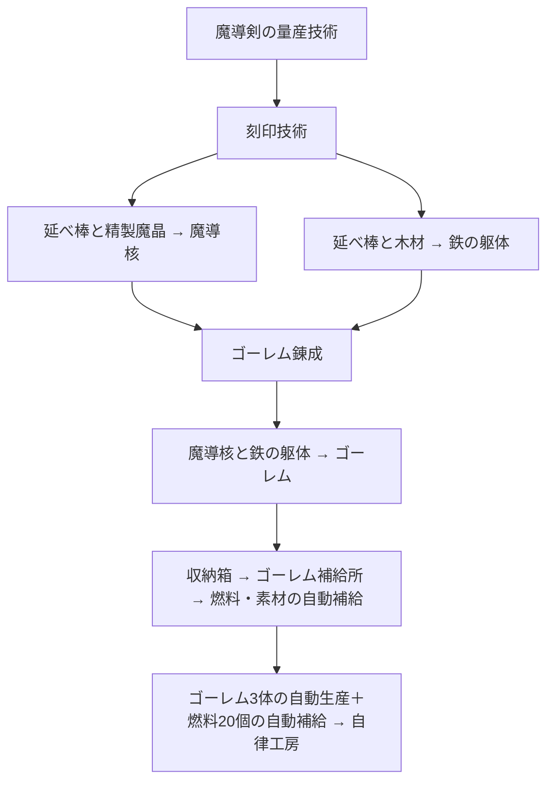

# 第三段階：ゴーレムによる自律補給

2026-10-15の追加依頼に対応。既存設計の「ゴーレムの自律作業」という次の構想を、製造と補給まで遊べる範囲へ具体化する。

| 研究 | 前提・実績 | 解放 |
| --- | --- | --- |
| 刻印技術 | 魔導剣の量産技術 | 刻印台・躯体工房、魔導核・躯体レシピ |
| ゴーレム錬成 | 刻印技術、魔導核3・鉄の躯体3の自動生産 | 覚醒炉・ゴーレム補給所、ゴーレムレシピ |
| 自律工房 | 錬成、ゴーレム3体の自動生産、木材20個の自動燃料補給 | 第三段階の達成 |

| 設備・レシピ | 材料 | 魔力 | 秒 | 建設費（木材／延べ棒） |
| --- | --- | --- | --- | --- |
| 刻印台：魔導核1 | 精製魔晶2＋延べ棒1 | 8 | 6 | 6／8 |
| 躯体工房：躯体1 | 延べ棒3＋木材2 | 6 | 6 | 8／10 |
| 覚醒炉：ゴーレム1 | 魔導核1＋躯体1 | 12 | 8 | 8／12 |
| ゴーレム補給所 | ゴーレム1体を配置 | — | 1品／秒 | 8／6 |

従来の延べ棒と精製魔晶の出力を分岐し、別々の中間素材を合流させる。増設すると魔力・鉄・木材が競合する。収納箱に備蓄するか、自動搬送を組み直すか、補給所の対象を切り替えるかが新しい判断になる。

## 補給所

ベルトから届いたゴーレム1体を補給所に配置すると、マンハッタン距離6以内の収納箱から、同範囲内の設備へ1秒に1品を運ぶ。燃料モードは魔力炉へ木材を補給する。素材モードは加工設備が使うレシピ素材を補給する。所持品から投入したゴーレムも配置できる。

燃料が少ない魔力炉や、素材が足りない加工設備を優先し、同条件では設備IDで決定する。素材の受入枠を守るため、組立機に延べ棒だけが入り続けても結晶用の枠は残る。収納箱から取り出す時は必要な品目を選び、その品目内の先着順を維持する。通常のベルト出力は従来どおりFIFO。

補給に魔力を使わず、魔力不足時にも燃料を届けられる。入力満杯、範囲外、収納箱に素材がない場合は品を失わず待機する。自動由来かつ手動で取り出されていない木材だけが20個の燃料実績へ数えられる。補給中の品の由来を保持し、回収・再投入で目標を増やせない。

補給所を選ぶと届く範囲と直近の搬送経路を表示する。燃料／素材は2つのボタンで切り替える。配置済みゴーレムは補給所の内部に保持され、撤去時に一度だけ回収する。

## 保存と目標

保存v3は新資源、研究、補給所のゴーレム・モード・待機時間・直近経路と補給実績を記録する。v1／v2は元の形式を検証してから移行し、設備・在庫・由来・作業進捗・魔力・達成済み研究を保持する。第三段階の資源・実績は0から追加し、研究条件を満たした次のノードを画面に表示する。読込だけでは保存枠を上書きしない。

新規・旧工房とも、鉄納品後、量産技術後、第三段階の各研究後に次の目的を選び直す。すべての研究を終えた工房は自由拡張へ進む。既存セーブを消去して進行を作り直す操作は不要。
