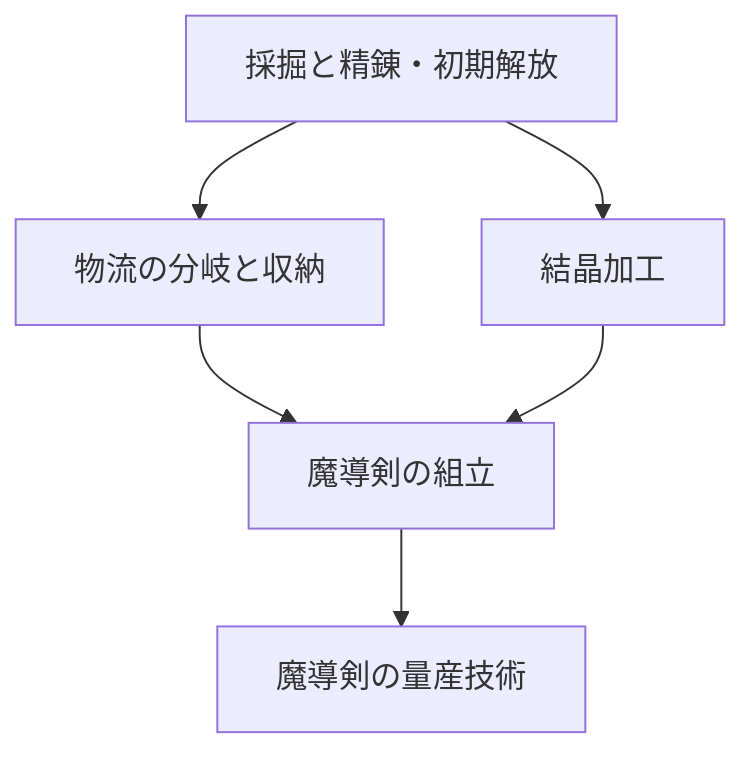

# 技術ツリーと魔導剣の自動量産

2026-10-13。初回の鉄の延べ棒ラインから進める第2段階の記録。2026-10-15に追加したゴーレムの第三段階は [stage3.md](stage3.md) を参照。

| 研究 | 前提と条件 | 解放 |
| --- | --- | --- |
| 物流の分岐と収納 | 採掘と精錬、延べ棒の自動生産5本 | 分岐器、収納箱 |
| 結晶加工 | 採掘と精錬、延べ棒の自動納品10本 | 魔晶採掘機、魔晶精製炉、精製魔晶レシピ |
| 魔導剣の組立 | 上記2研究、延べ棒の自動生産30本、精製魔晶の自動生産10個 | 組立機、魔導剣レシピ |
| 魔導剣の量産技術 | 組立、最高10本/ゲーム内分、魔導剣の自動納品10本 | 達成表示、第三段階の刻印技術への前提 |

条件を満たすと「研究する」を押せます。研究に資材の追加支払いはありません。「追跡する」で地図上の短い進捗表示へ追跡でき、研究後も解除できます。建設やレシピ変更でも研究状態を検証します。

## 生産と増設

| レシピ | 材料 | 魔力 | 時間 | 製品 |
| --- | --- | --- | --- | --- |
| 鉄の延べ棒 | 鉄鉱石2 | 5 | 4秒 | 延べ棒1 |
| 精製魔晶 | 魔晶原石1 | 3 | 3秒 | 精製魔晶1 |
| 魔導剣 | 延べ棒2＋精製魔晶1 | 8 | 4秒 | 魔導剣1 |

魔晶採掘機は紫の結晶鉱脈上に置き、魔力2で2秒ごとに原石1個を出します。新規地図の中央付近 `(20,16)` と `(20,15)` に鉱脈があります。建設パレットで選ぶと対象を見える位置へカメラを移します。

| 設備 | 建設費（木材／延べ棒） | 機能 |
| --- | --- | --- |
| 分岐器 | 2／2 | 正面と時計回り側面へ交互に出力。詰まった口を避けて空いた口へ送る |
| 収納箱 | 6／2 | 32個のFIFO保管、正面へ出力 |
| 魔晶採掘機 | 4／8 | 結晶鉱脈から原石を採掘 |
| 魔晶精製炉 | 4／8 | 原石を精製魔晶へ加工 |
| 組立機 | 6／12 | 延べ棒と精製魔晶から魔導剣を組立 |

増設資材は初期資材に加え、納品前の延べ棒を収納箱へ寄せて回収すると確保できます。納品箱へ入れた品は消費され、回収できません。森林があればメニューの「木材を手採取」で木材1個を得られます。これは自動生産実績には加算されません。

組立機1台の理論上限は15本/分です。採掘機2台、魔導炉2台、魔晶採掘機・魔晶精製炉・組立機各1台、燃料を供給した魔力炉3台を配線・搬送でつなぐ実ラインで、直近60ゲーム秒に15本を確認しました。素材と配線を共有すると魔力の競合が起こるため、不足表示を確認して増設してください。混合素材は品目ごとの受入枠を持ち、一方だけで庫内が埋まって永久停止することを防ぎます。

## 速度と自動実績

「現在」は直近60ゲーム秒に完成した自動由来の剣の本数です。停止中はゲーム時間が進まず、2倍速は実時間で早く進むだけです。「最高」は過去の60秒窓の最大値を保持し、研究条件に使います。累積生産・累積納品とは別に表示します。

採掘から加工・ベルト搬送まで自動でつながる品を実績へ数えます。燃料木材の手動補給は採掘の自動由来を変えません。収納箱や設備から手で回収した品は元の由来と取出し履歴を保持し、再投入しても自動生産・自動納品へ二重加算しません。

納品箱は延べ棒と魔導剣だけを受け入れます。初期目標は銀色の延べ棒100本の自動納品。魔導剣の納品は技術ツリー側で別に数えます。

## 収納・操作・保存

収納箱は最大32個を先入れ先出しで保持します。満杯では上流が停止し、空きを作ると再開します。詳細に品目別の数量と自動・手動取出し履歴を表示し、品目・個数を指定して回収できます。撤去でも内部品を回収します。作業中の予約素材は通常の回収対象から外し、撤去時に一度だけ回収します。

主メニュー、操作説明、設備詳細、建設パレット、技術ツリーに閉じる操作を設け、対応ボタンから開き直せます。建設パレットを閉じると建設モードを解除します。UI操作を地図に伝播させません。

保存v2は研究・生産統計・直近の完成時刻・品の履歴・収納順序も保存します。旧v1は設備・内部品・進捗・魔力・納品実績を保持して移行し、旧データから分かる自動生産数だけを控えめに復元します。読み込むだけでは保存枠を上書きせず、明示的な「保存」でv2へ更新します。

旧地形の空いた草地へ結晶鉱脈を追加します。すべて建物で埋まっている場合は既存設備や資源を保持し、指定草地区画の設備を撤去すると結晶鉱脈が現れます。進行を詰ませるために設備を勝手に消すことはありません。不明な版や破損データは拒否します。

検証結果と画像は [playtest.md](playtest.md) に記録します。

## 新規工房からの到達確認

`npm run check:fantasy-progression` は初期seed662の通常工房から、成功したゲーム命令だけで第2段階までの研究を進めます。資材・地形・研究・統計の直接書換えはありません。収納箱から回収した延べ棒を建設費に使い、木材の手採取と燃料の手動補給を行います。製品の自動判定はそのままです。

物流34.5秒、結晶加工55.05秒、組立158.55秒、量産技術326.6秒（すべて操作待ち時間を含まないゲーム内時間）で到達。完成ラインの連続60秒は魔導剣15本、納品は累計25本です。これはソフトロックや建設費の循環がないことの確認で、初心者の実際の所要時間測定ではありません。配置・命令数・実績の詳細は `artifacts/fantasy-automation/technology/reachability.json` に保存しています。
