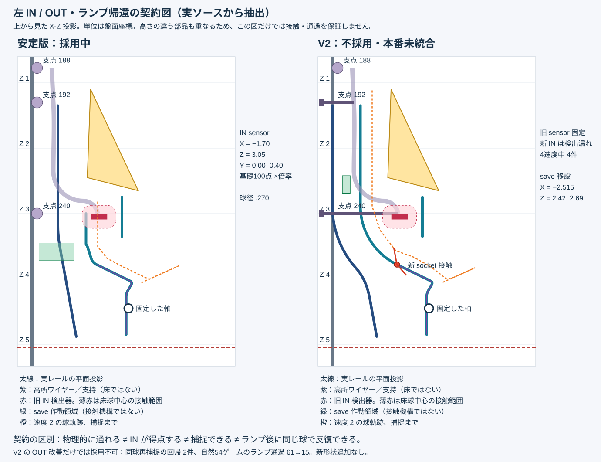

# IN/OUT とランプ帰還の現状・契約

対象は安定版 c87f117（ゲーム本体は 1ba467c と同一）と、不採用の V2 source SHA 07a6cbc5fc9d4dce4ea1d40d859340c6b56c63e52a16d09fc9dc9380da9d9607。本調査では形状、センサー、操作、得点を変更していません。

図は実ソースから出力した X-Z 投影です。紫のワイヤーや横梁は高所にあり、平面上の重なりだけでは衝突を意味しません。橙線は同じ速度2で始めた別々の入口の実測軌跡であり、同一初期条件の新旧対照ではありません。安定版は旧捕捉位置、V2は新IN入口です。同一初期条件の比較結果は前回保存した試験を参照します。

## 安定版の現状

- 両フリッパーの軸は X=±1.25、Y=.27、Z=4.45。長さや操作は今回変更していません。
- 左INの外側dividerは X=-1.90、Z=3.00から始まり、短い内向き曲線でheel側へ寄ります。内側railは X=-1.35、Z=2.75..3.35。曲線の描画と物理は同じ点列ですが、管の端部表示と独立mountの接触には既知の未完があります。
- OUT外側railは X=-2.33、Z=1.35..3.35から X=-2.05、Z=4.88へ延びます。OUTはフリッパーへ戻す通路ではなく、未充電なら排出する通路です。
- 左wire出口の経路基準点は X=-1.72、Y=.44、Z=3.00（球中心の基準高さは .575、実wire軸は別の高さoffsetを持つ）。出口接線はほぼ+X方向で、Z/X比=.171です。球は高所から床と捕捉部へ移ります。出口へ球を置く局所試験と、実際にランプを一周した帰還試験は別です。
- 安定版は直近の全212テストを通過しています。ただし参考一致、全可視金物の接触、heel重なり、実機スマホ、人間プレイの完了証明ではありません。

## 流路とイベントの契約

| 項目 | 実装上の条件 | 成功とみなしてはいけない代用 |
| --- | --- | --- |
| IN物理経路 | 球が実レール・スリング・wire・支持を通り、batへ届く | ラベルがINに見えるだけ、途中へ球を置くだけ |
| IN検出・得点 | 非ブロッキングbox中心 X=±1.70/Y=.20/Z=3.05、半寸法(.125,.20,.04)への衝突開始。playing/非tilt、イベント重複なし、同key .16秒cooldown。基礎100点×倍率 | その近くを通るだけ、印字だけ移す、通路全体を無条件に得点領域にする |
| 捕捉 | 実bat接触を経て球が保持位置で静止する | 低速に強制変更、位置補正、saveで救済 |
| 再発射 | 既存キーを離して再押下し、実bat接触で上流へ返る | coil回数のみ、または得点だけ増える |
| OUT排出 | 未充電で自然にdrainへ到達し、球番号が正常に進む | INへひそかに迂回、見えない壁や位置reset |
| 左save | workshop達成で1charge。旧領域 X(-2.62,-2.08)、Z(3.45,3.72)、Y<.5、下降vz>0、非tilt。1charge消費し、既存直接impulseでvx=0/vz=-12、vy維持 | 実actuator完成との同一視。現状は絵のrodと直接impulseであり有限仕事の可動機構ではない |
| ランプ通過 | 実ランプに沿う3つの高所gateを順番・前進方向で30秒以内に通る。基礎300点×倍率 | 下の床を走る、逆走、1個のgate接触のみ |
| 同球帰還と反復 | ランプ通過後に同じ球を再捕捉し、再操作で上流へ返す。rescue/resetなし | ランプ得点が入っただけ、次の球を発射する |

Ramp stageは30秒超過または球Y<.28で解除されます。球が通常drain領域へ到達した場合は新しい球へ進むため、同球反復とは区別します。

## 参考画像との主な差

正本は neon-reference.png のROBOBUDDY画像です。透視図のイラストなので、数値CADや強度の仕様として扱いません。

1. 参考はスリング横から下部へ長く読み取りやすいIN/OUTが並びます。安定版はIN入口が短く、内向きの曲がりと露出した大きいcapが目立ちます。
2. 参考はwireと下部支持が盤面の構造へまとまっています。安定版の横梁・柱の配置は大きく露出します。V2の筐体支持は接続を作ったものの、それだけで参考一致にはなりません。
3. 参考のランプ入口、後方の曲がり、右ターゲットと周辺支持は一体に見えます。安定版はその輪郭・間隔・細部造形に差があります。今回左レーンだけを変えても、この差は未解決です。
4. 印刷のgearやレーン矢印は改善済みですが、立体構造・接触・機構が完成したことを意味しません。

## 不採用V2で分かったこと

- OUT床中心線の757点は通れ、移設saveの50条件も成立しました。しかしこれはOUTの局所能力の結果です。
- 同じ旧捕捉位置の28操作では、捕捉数と上流refireの成功delay集合は維持されました。ただし到達時刻と後続軌跡は変わっています。
- 新IN入口からの4速度では、全4件で旧INセンサーを外れます。捕捉したのは速度2の1件だけでした。他の3件はbatを触って横切り、排出。これを「IN機能完成」とは言えません。
- 全回帰200/212。実ランプを通った後の同球再捕捉が2件失敗しました。
- 同じ入力制御による自然54ゲームではランプ61→15。合計得点増や停止なしを理由に採用しません。

次の形状案を作る前に、帰還する球の接触点、速度・方向、持ち上がり、batへ届く位置を旧版と対応させて測定します。初期の撃ち出しが既に違う場合と、ランプ出口後に初めて違う場合を分離します。単一fixtureの原因を54ゲーム全体の原因と断定しません。

## 接触計測で絞れた原因と次の局所案

代表のdelay81帰還で、新しいjoin socket（X=-1.741021、Y=.22、Z=3.778770、半径.040）への追加接触を測定しました。その接触後に旧tail railへ続けて当たり、横方向の速度を残したまま左batを横切り、反対側へ流れて排出します。旧tailの点列が同じでも、接触する形状の集合と順番は同じではありません。

自然なfixtureでは撃ち出し前の捕捉段階から微小な差が発生しているため、その一例だけを因果証明にしません。同一の合法な帰還位置・速度・spinとbat姿勢を与える別対照を行い、安定版は捕捉→再発射、V2は排出、V2の当該socket1個だけ接触無効にした診断では捕捉→再発射へ戻ることを確認しました。無効化は描画と物理が食い違う原因検査であり、採用案ではありません。接触履歴を完全に復元したものでもなく、54ゲーム全体の減少原因を一つで説明する結果ではありません。

次に検討する変更範囲は、まずこの接合部の支持位置・外形だけです。新しい寸法はまだ決めていません。

- 採用しない案：socketを見せたまま接触だけ消す、隠れた壁を加える、球速度を補正する、batの力や入力を変えて救済する。
- 比較対象となり得る案：戻り球の通過体積へ突き出さない接合位置・外形と、実際につながる支持構造を一体で設計する。薄くすればよいとは仮定せず、軸・座面・締結と描画/接触を揃える。
- 最初の判定：同一帰還状態の対照、実ランプからの帰還、自然IN入口をともに通す。OUTとsaveの幅・充電/非充電挙動も維持する。
- 次の判定：旧80..84と連続打点、全212回帰、入口反復、自然54ゲーム、多視点と実入力を再確認する。検出器の移設は別の明示的変更として行い、捕捉失敗を得点修正で隠さない。

図の赤い折線はこの追加接触で観測した水平速度方向の模式表示で、球の位置軌跡や力のベクトルそのものではありません。詳しい時刻・法線・impulse・対照条件は別の計測資料へ保全します。

## 保全した計測と再現

`evidence/paired-findings.json` は通常の同順序fixtureにおける接触計測、`evidence/same-state-summary.json` は同一帰還状態の3対照です。後者の共通状態は安定版 lower-layout delay81、tick1122後の位置・速度・spinです。各fresh processは1world、0.25秒held-leftでbatを揃え、同じ状態から最大7.5秒保持し、捕捉した場合は.375秒離して2.5秒再入力します。旧版とsocket無効対照は実coil `[1,0]`、上流minZ −2.368545／−2.299319。V2は通常排出します。球位置resetは全0です。

再現用の `replay-control.mjs` と `initial-state.json` は元の大きなtraceなしで実行できます。前回の `left-lane-frame-unadopted/restore.mjs` でV2を新しいartifactディレクトリへ復元し、その `baseline-loader.mjs` または `loader.mjs` を Node の `--import` に指定してください。引数は baseline、candidate、candidate-socket-disabled。出力先は環境変数 OUTPUT_DIR=artifacts/pinball/任意の新規名 で指定します。未知のmode、productionへの出力、既存結果の上書きは拒否します。実行はrepo rootから行います。

独立再実行した3対照の出力は、保存した元の計測とバイト単位で一致しました。再実行用の大きな複製は検証後にゴミ箱へ移しました。元の生traceは出典ハッシュ付きでartifactへ残し、ここには主要接触と結果を保存しています。`replay-verification.json` に照合結果があります。繰り返し一致はこの手順の確認であり、異なるworld履歴に対する決定性保証ではありません。

`python3 docs/pinball-experiments/lane-contract-and-return-cause/draw.py` は保存済みの寸法・軌跡からSVGを再生成します。新しいゲーム形状は作りません。export.mjsは元抽出の記録であり、元のartifact loaderに依存します。図のオレンジ線は異なる入口の例示なので、同条件の比較根拠には用いていません。

全54ゲームのランプ61→15をこの一部品だけで説明したわけではありません。全回帰・新規形状の採用検証・実機スマホ／人間プレイは今回新たに実施していません。安定版本体は変更していません。
